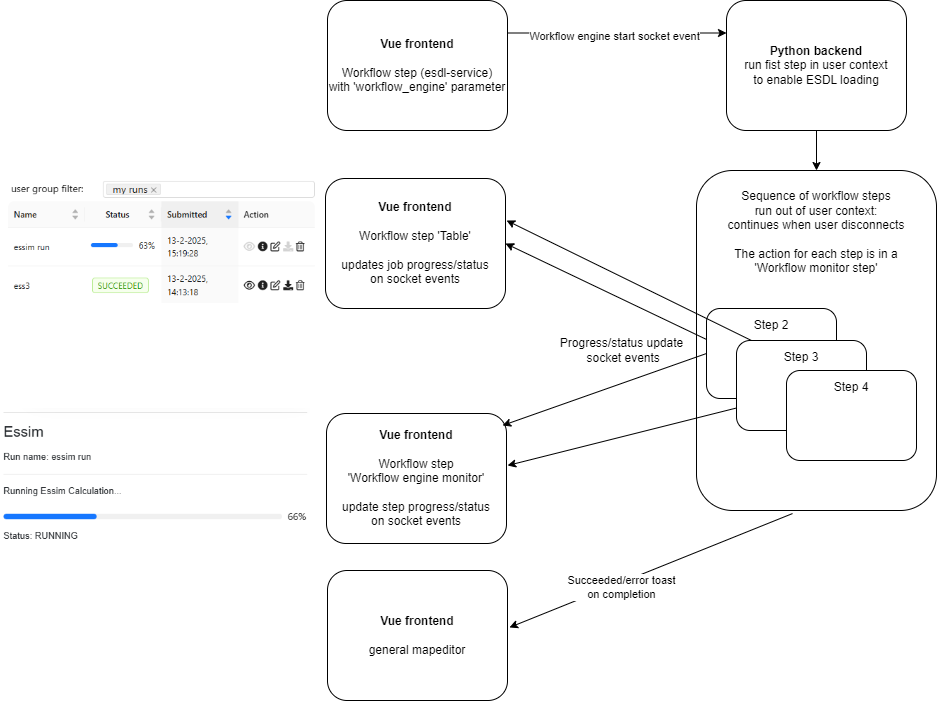

# Workflow steps

A workflow is defined as a list of workflow steps. There are several different kind of steps (types).
A fully up-to-date set of workflow steps can be found by looking in `vue/apps/Workflow.vue` and `workflow.js` file,
which contains an enum of all possible steps.

The configuration of a workflow can be tricky with many configuration options. This overview is meant to help with this.
There are workflow step general configuration parameters which will be discussed below. An overview of the available
step types with the type specific configuration and data input and output can be found in
the [Step Types](step_types.md) page.

## General workflow step parameters

There are general workflow step parameters which are the same for each workflow step type:

- `id`  
  step id string (must be unique)
- `name`  
  used as title, if not provided the title will not be displayed
- `description`  
  used as subtitle, if not provided the subtitle will not be displayed
- `type`  
  workflow step type, any of the types described in the [Step Types](step_types.md) page
- `config`  
  parameters specific for the chosen workflow `type`, described in the [Step Types](step_types.md) page
- `button_text`  
  button text: if not provided, no button will be displayed
- `data`  
  where to get/send data, see [data](#data)
- `reload_on_esdl_activation`  
  boolean option to reload the input data when another ESDL is selected, `false` when not provided, implemented for the
  `json-form2`, `select`, `text` types.
- `next_step`  
  workflow step id to which the workflow moves on submit, alternatively rules and conditions are possible,
  see [next_step](#next_step)
- `previous_step`  
  workflow step id to which the workflow moves on 'back'
- `next_step_trigger`  
  when top move to the next workflow step, options:
    - `loading_complete`: move to the next step when the input data is loaded
    - `input_change`: move to the next step on any gui value update (this is used in a `composite-step` to relay updated
      data to the other workflow steps in the composite step)
    - `button_click`: (default value is not provided) move to next on button click, the button is only displayed with
      this option
- `workflow_engine`  
  run (a) step(s) in the backend in the workflow engine, this way a sequence of steps can be run decoupled from
  the frontend workflow, see [workflow_engine](#workflow_engine)

### `data`

The data parameters determines how the workflow step gets input data and where to send the output data to.
There is a workflow state object which data can be saved to and retrieved from between different steps.

Step input data can be provided directly as configuration, or retrieved from state, an url of from a socket event.
The data from all the chosen options is combined into one data object.
Each step type must implement a function how to deal with the received data, to attach it to the proper UI components.

- `from_config`  
  add the json in this dict object to the input data
- `from_state`  
  get data from the workflow state, for each key-value pair: the key indicates the name of variable, the value is the
  name of the state variables to get the value from, nested variable can be obtained using a dot.
- `from_url`  
  get data from url, must contain a `url` and optional `query_parameters` which is a list of objects with a `name` and
  either a `value` (to be used as is) or `parameter_name` (state parameter name to get the value from), the response of
  the request will be added to the input data, it is possible to wrap the output into a variable by adding a
  `wrapper_variable` parameter.
- `from_socket`  
  get data from a socket event, must contain an `event` and optional `params` and/or `state_params` with key-value pairs
  to be sent with the socket event, the response of the socket event will be added to the input data, it is possible to
  wrap the output into a variable by adding a `wrapper_variable` parameter.

Step output data can be sent, on the `next_step_trigger`, to state, an url or a socket event. Optionally the output can
be wrapped in a variable.

- `output_wrapper_variable`  
  name of the variable to output will be wrapped in, optional, if not present the data is sent as is
- `to_state`  
  add the data to the workflow state, this will be an empty object since no additional configuration is needed
- `to_url`  
  post data to an url, must contain `url`
- `to_socket`  
  send data in a socket event, must contain: `event`

Below is an `data` configuration example:

```json
{
  "from_config": {
    "filter_on_tag": {
      "tag_name": "simulationRun",
      "value_database_key": "model_job_id"
    }
  },
  "from_state": {
    "run_id": "model_run.run_id"
  },
  "from_url": {
    "url": "http://localhost:8112/essim/simulation/kpiModules/"
  },
  "from_socket": {
    "event": "external_models_get_run_text",
    "state_params": {
      "run_id": "model_run.run_id"
    },
    "wrapper_variable": "model_text"
  },
  "output_wrapper_variable": "model_run",
  "to_socket": {
    "event": "external_models_update_run"
  }
}
```

### `next_step`

The workflow step id (string) to which the workflow moves on submit, alternatively rules and conditions are possible,
see the example below.

```json
{
  "if": [
    {
      "condition": "AND",
      "rules": [
        {
          "field": "favorite_language",
          "operator": "neq",
          "value": "Python"
        },
        {
          "field": "age",
          "operator": "gte",
          "value": 30
        }
      ],
      "then": "old_non_python_programmer_step"
    },
    {
      "condition": "OR",
      "rules": [
        {
          "field": "age",
          "operator": "gte",
          "value": 30
        },
        {
          "field": "programming_languages",
          "operator": "gte",
          "value": ""
        }
      ],
      "then": "old_polyglot_step"
    }
  ],
  "else": {
    "then": "remainder_step"
  }
}
```

### `workflow_engine`

The processing of a (sequence of) workflow step(s) can be run in the backend. This way the workflow can move
automatically on to subsequent steps without needing user input. Also, the process will continue when clicking away the
workflow or when the user logs out.   
To start a workflow engine sequence a `workflow_engine` configuration is needed. Currently, this is only implemented for
the `esdl-service` workflow step type. Subsequent steps are of type `workflow-engine-monitor` which contains the action
to perform, and optionally this step can be displayed to track the progress of the workflow engine sequence. For now
only one action is implemented: `model_run_result_polling`. Others can be implemented in
`extensions/workflow_engine.py`.


