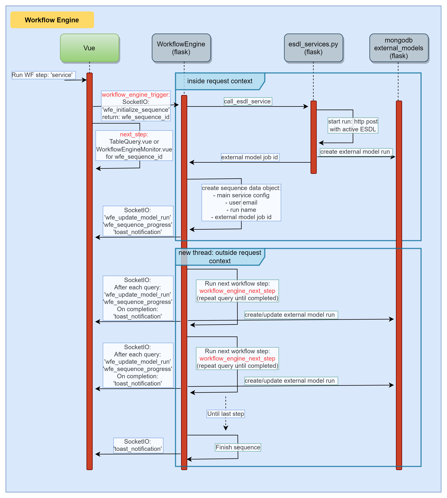

# Workflow engine

The workflow engine can do a sequence of workflow steps as a flask backend process.
The benefit of this is:

- the calculation will continue when the user is logged off
- multiple calculations can run concurrently
- multiple calculations (external models) can be chained

## Sequence diagram

