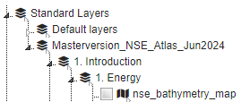

# Prerequisites

- Install `requirements.txt` in this folder on top of the MapEditor requirements (these are not necessary for the
MapEditor itself). 
  
  Be noted that `GDAL` is the required dependency for using `geoserver-rest`. See documentation for GDAL installation: https://geoserver-rest.readthedocs.io/en/latest/installation.html#installation

- Copy the `.env.template` to `.env` and update the values.

- The targeted PostgreSQL database (specified by `POSTGRES_DB` in your `.env` file) should have `postgis` extension installed to store geospatial data as tables.

## Load geospatial data in geoserver and add as wms layers

This allows to upload geospatial files to postgis and geoserver, and load these WMS layers in the mapeditor.    

All layers in a specified folder path (and its subfolders) will be loaded. The last folder in the path will be added as
a group and the subfolders will be loaded as nested groups in the mapeditor. For instance if the folder path
is `C:\Users\Masterversion_NSE_Atlas` and a file is in
`C:\Users\Masterversion_NSE_Atlas_Jun2024\1. Introduction\1. Energy\NSE_bathymetry_map.tif`, the mapeditor tree will
look like this:  
  

Below a description of the steps needed and possible options.

1. Optionally create Geoserver instance  
   Use `docker compose up` in `/scripts/docker` folder for local geoserver instance.

2. Set `.env` values (see `.env.template` for example values):
    - `FOLDER_PATH`: Path to folder which will be searched during `get_file_paths.py` and used in `load_wms_layers.py`
      to get the relative file path for creation of subgroups
    - `LIST_TO_IMPORT_FILE`: (Relative) path to output file for `get_file_paths.py` and input file
      for `load_wms_layers.py`
    - `ALLOWED_EXTENSIONS`: Comma separated list of file extensions which will be picked up in `get_file_paths.py`.
    - `RASTER_EXTENSIONS`: Comma separated list of file extensions which will be directly loaded in geoserver, not via
      postgis
    - `OVERWRITE_POSTGIS_GEOSERVER`: Option to overwrite postgis and geoserver entries (mapeditor mongo entries are
      never overwritten, they can be easily deleted in the mapeditor)
    - `ABORT_ON_LAYER_ERROR=false`: Abort when an error is encountered (previous postgis/geoserver loads are done but
      nothing will not be loaded in mapeditor)
    - `RASTER_DEFAULT_TRANSPARENCY`: Default transparency for raster files
    - `VECTOR_DEFAULT_TRANSPARENCY`: Default transparency for vector files
    - `SETTING_TYPE`: Mapeditor setting type (`system` or `project`)
    - `PROJECT_NAME`: Mapeditor project name (only used when `SETTING_TYPE` is set to `project`)
    - `GEOSERVER_URL`: Geoserver url
    - `GEOSERVER_ADMIN_USER`: Geoserver user
    - `GEOSERVER_ADMIN_PASSWORD`: Geoserver password
    - `GEOSERVER_WORKSPACE`: Geoserver workspace
    - `GEOSERVER_STORENAME`: Geoserver store name
    - `POSTGRES_HOST`: Postgres host
    - `POSTGRES_HOST_INTERNAL`: Postgres internal host (used by geoserver: postgres does not have to be public)
    - `POSTGRES_PORT`: Postgres port
    - `POSTGRES_PORT_INTERNAL`: Postgres internal port (used by geoserver: postgres does not have to be public)
    - `POSTGRES_USER`: Postgres user
    - `POSTGRES_PASSWORD`: Postgres password
    - `POSTGRES_DB`: Postgres database
    - `MONGO_URL`: MongoDB url

3. Run `get_file_paths.py`  
   This will result in a .csv file (`LIST_TO_IMPORT_FILE`) with a geospatial data file path per line.

4. Optionally insert .sld file paths per layer for custom styling. Raster file colors will be autoscaled by default.  
   Optionally remove lines for layers that should not be loaded.

5. Run `load_wms_layers.py`  
   This will load the geospatial files in postgis and geoserver, and the mapeditor (via updating MongoDB settings).
