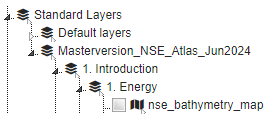

# Prerequisites

- Install `requirements.txt` in this folder on top of the MapEditor requirements (these are not necessary for the
  MapEditor itself). Use a dedicated virtual environment at `scripts/wms_layers/.venv`, including the MapEditor
  dependencies. The WMS requirements explicitly include `pyESDL` and `psycopg2-binary`.

  GDAL is required by `geoserver-rest`. The local Windows setup has been verified with Python 3.10 (64-bit), GDAL 3.4.3,
  and psycopg2. Use a GDAL wheel matching your Python version and architecture. See the GDAL installation:
  https://geoserver-rest.readthedocs.io/en/latest/installation.html#installation

  Vector imports also invoke the external `ogr2ogr` command. Installing the Python GDAL package alone does not ensure
  that command is available. Install the GDAL command-line tools and check `ogr2ogr --version` in the terminal used to
  run the loader.

- Copy the `.env.template` to `.env` and update the values.

- The targeted PostgreSQL database (specified by `POSTGRES_DB` in the `.env` file) should have `postgis` extension
  installed to store geospatial data as tables.

## Runtime and configuration

Run the scripts from `scripts/wms_layers` so relative CSV and style paths resolve as expected. For an existing local
environment, use these PowerShell commands from that folder:

```powershell
.\.venv\Scripts\Activate.ps1
$env:PYTHONPATH = (Resolve-Path ../..).Path
```

The WMS debug configurations in the repository's `.vscode/launch.json` select this local `.venv` and set the working
directory and `PYTHONPATH` automatically.

`load_wms_layers.py` explicitly loads the `.env` beside the script before importing MapEditor modules. Those imports
initialize application settings and otherwise load the repository-root `.env` first. Loading the script's configuration
first prevents mixing the root database user with the script's database password. This import order is intentional and
must be preserved.

## Load geospatial data in geoserver and add as wms layers

This allows to upload geospatial files to postgis and geoserver, and load these WMS layers in the mapeditor.

All layers in a specified folder path (and its subfolders) will be loaded. The last folder in the path will be added as
a group and the subfolders will be loaded as nested groups in the mapeditor. For instance if the folder path is
`C:\Users\Masterversion_NSE_Atlas_Jun2024` and a file is in
`C:\Users\Masterversion_NSE_Atlas_Jun2024\1. Introduction\1. Energy\NSE_bathymetry_map.tif`, the mapeditor tree will
look like this:  


Below a description of the steps needed and possible options.

1. Optionally create Geoserver instance  
   Use `docker compose up` in `/scripts/wms_layers/docker` folder for local geoserver instance.

2. Set `.env` values (see `.env.template` for example values):
   - `FOLDER_PATH`: Path to folder which will be searched during `prepare_wms_layers.py` and used in
     `load_wms_layers.py` to get the relative file path for creation of subgroups
   - `LAYERS_WITH_STYLE_FILE`: (Relative) path to output file for `prepare_wms_layers.py` and input file for
     `load_wms_layers.py`
   - `SUPPORTED_VECTOR_EXTENSIONS`: Comma separated list of vector file extensions which will be picked up in
     `prepare_wms_layers.py` and loaded in postgis and geoserver.
   - `SUPPORTED_RASTER_EXTENSIONS`: Comma separated list of raster file extensions which will be picked up in
     `prepare_wms_layers.py` and directly loaded in geoserver, not via postgis
   - `OVERWRITE_POSTGIS_GEOSERVER`: Option to overwrite postgis and geoserver entries (mapeditor mongo entries are never
     overwritten, they can be easily deleted in the mapeditor)
   - `ABORT_ON_LAYER_ERROR`: When `true`, stop on a layer error. Earlier PostGIS/GeoServer changes remain, but the
     MapEditor layer settings are not saved. When `false`, skip the failed layer and continue.
   - `RASTER_DEFAULT_TRANSPARENCY`: Default raster opacity (`0` is transparent; `1` is opaque)
   - `VECTOR_DEFAULT_TRANSPARENCY`: Default vector opacity (`0` is transparent; `1` is opaque)
   - `SETTING_TYPE`: Mapeditor setting type (`system` or `project`)
   - `PROJECT_NAME`: Mapeditor project name (only used when `SETTING_TYPE` is set to `project`)
   - `GEOSERVER_URL`: Geoserver url
   - `GEOSERVER_ADMIN_USER`: Geoserver user
   - `GEOSERVER_ADMIN_PASSWORD`: Geoserver password
   - `GEOSERVER_WORKSPACE`: Geoserver workspace
   - `GEOSERVER_STORENAME`: Geoserver store name
   - `POSTGRES_HOST`: Postgres host
   - `POSTGRES_HOST_INTERNAL`: Postgres internal host (used by geoserver: postgres does not have to be public)
   - `POSTGRES_PORT`: Postgres port
   - `POSTGRES_PORT_INTERNAL`: Postgres internal port (used by geoserver: postgres does not have to be public)
   - `POSTGRES_USER`: Postgres user
   - `POSTGRES_PASSWORD`: Postgres password
   - `POSTGRES_DB`: Postgres database
   - `MONGO_URL`: MongoDB address without the `mongodb://` prefix (for example, `localhost:27017`)

3. Run `python prepare_wms_layers.py` in the local environment.  
   This will result in a .csv file (`LAYERS_WITH_STYLE_FILE`) with a geospatial data file path per line.

4. Optionally insert .sld file paths per layer for custom styling. Raster file colors will be autoscaled by default.  
   Optionally remove lines for layers that should not be loaded.

5. Run `python load_wms_layers.py` in the local environment.  
   This will upload the geospatial files and styles in the `LAYERS_WITH_STYLE_FILE` file to postgis and geoserver, and
   the mapeditor.
